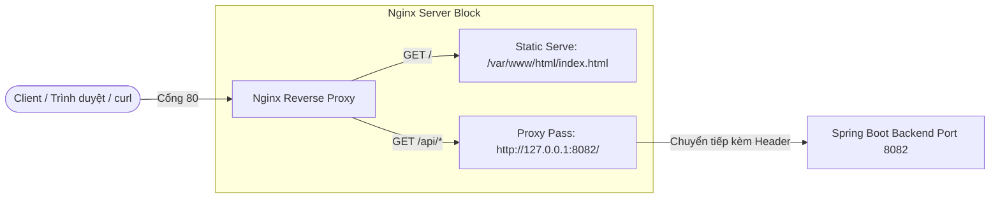

# Báo Cáo Bài Tập 4: Cấu Hình Reverse Proxy Nginx Cho Ứng Dụng Spring Boot

- **Họ và tên:** An Hải Dũng
- **Email:** anhaidung2k6@gmail.com
- **Mã lớp:** DevOps K26
- **Khóa học:** DevOps Engineering
- **Đường dẫn nộp bài:** `homework/session_07/ex4/`

---

## 1. Mục Tiêu & Bối Cảnh

- **Mục tiêu:** Cấu hình máy chủ ảo Nginx Server Block làm Reverse Proxy định tuyến lưu lượng mạng, kết hợp cơ chế **Path Matching** để:
  1. Phục vụ nội dung tĩnh trực tiếp từ `/var/www/html/` khi người dùng truy cập trang chủ (`/`).
  2. Định tuyến các yêu cầu API bắt đầu bằng `/api/` an toàn về ứng dụng Spring Boot backend đang chạy tại cổng `8082` (`http://127.0.0.1:8082/`).
- **Yêu cầu kỹ thuật:**
  - Tạo cấu trúc thư mục tĩnh `/var/www/html/` và tệp `index.html` hiển thị thông tin học viên.
  - Tạo tệp cấu hình Nginx Server Block tại `/etc/nginx/sites-available/spring-proxy.conf`.
  - Tạo liên kết mềm (symlink) sang `/etc/nginx/sites-enabled/`.
  - Đảm bảo `nginx -t` kiểm tra cú pháp thành công trước khi reload service.
  - Kiểm tra `curl -I http://localhost/` trả về HTTP 200 và `curl -I http://localhost/api/health` trả về kết quả từ Spring Boot backend (không bị 502 Bad Gateway).

---

## 2. Mô Hình Kiến Trúc Hệ Thống



---

## 3. Chi Tiết Tệp Cấu Hình Nginx (`spring-proxy.conf`)

Tệp được đặt tại: `/etc/nginx/sites-available/spring-proxy.conf`

```nginx
# ==============================================================================
# Nginx Virtual Host / Reverse Proxy Configuration
# Bài 4: Cấu hình Reverse Proxy Nginx cho ứng dụng Spring Boot
# ==============================================================================

server {
    listen 80;
    server_name localhost;

    # --------------------------------------------------------------------------
    # 1. Đường dẫn / (Static Serve): Phục vụ trang tĩnh trực tiếp
    # --------------------------------------------------------------------------
    location / {
        root /var/www/html;
        index index.html index.htm;
        try_files $uri $uri/ =404;
    }

    # --------------------------------------------------------------------------
    # 2. Đường dẫn /api/ (Reverse Proxy): Chuyển tiếp sang Spring Boot (Port 8082)
    # --------------------------------------------------------------------------
    location /api/ {
        # Chuyển tiếp lưu lượng đến ứng dụng Spring Boot chạy tại cổng 8082
        # Với URI kết thúc bằng '/', Nginx sẽ chuyển tiếp URI sau prefix /api/
        proxy_pass http://127.0.0.1:8082/;

        # Thiết lập HTTP Header chuyển tiếp để Backend nhận diện đúng Client
        proxy_set_header Host $host;
        proxy_set_header X-Real-IP $remote_addr;
        proxy_set_header X-Forwarded-For $proxy_add_x_forwarded_for;
        proxy_set_header X-Forwarded-Proto $scheme;

        # Cấu hình timeout tối ưu kết nối
        proxy_connect_timeout 60s;
        proxy_send_timeout 60s;
        proxy_read_timeout 60s;
    }
}
```

### Giải thích các chỉ thị quan trọng:
1. **`root /var/www/html`**: Chỉ định thư mục gốc chứa các file tĩnh được Nginx phục vụ trực tiếp cho route `/`.
2. **`try_files $uri $uri/ =404`**: Kiểm tra sự tồn tại của file hoặc thư mục trước khi trả lỗi 404 Not Found.
3. **`proxy_pass http://127.0.0.1:8082/`**: Chuyển tiếp toàn bộ request đến server Spring Boot backend chạy nội bộ tại port 8082.
4. **`proxy_set_header Host $host`**: Giữ nguyên thông tin domain/host ban đầu mà client gửi lên request.
5. **`proxy_set_header X-Real-IP $remote_addr`**: Gửi địa chỉ IP thật của client đến backend, tránh trường hợp backend chỉ nhận được IP nội bộ của Nginx (`127.0.0.1`).
6. **`proxy_set_header X-Forwarded-For $proxy_add_x_forwarded_for`**: Danh sách chuỗi các địa chỉ IP mà request đã đi qua (hữu ích khi qua nhiều tầng proxy/load balancer).
7. **`proxy_set_header X-Forwarded-Proto $scheme`**: Chuyển tiếp giao thức kết nối (`http` hoặc `https`).

---

## 4. Các Bước Triển Khai Thực Tế

### Bước 1: Chuẩn bị thư mục và tệp tĩnh `index.html`
```bash
# Tạo thư mục gốc chứa file tĩnh
sudo mkdir -p /var/www/html

# Copy file index.html vào thư mục tĩnh
sudo cp index.html /var/www/html/index.html

# Phân quyền truy cập cho user web www-data
sudo chown -R www-data:www-data /var/www/html
sudo chmod -R 755 /var/www/html
```

### Bước 2: Tạo tệp cấu hình Virtual Host Nginx
```bash
# Đưa file cấu hình vào sites-available
sudo cp spring-proxy.conf /etc/nginx/sites-available/spring-proxy.conf
```

### Bước 3: Kích hoạt cấu hình (Enable Site)
```bash
# Gỡ cấu hình mặc định (nếu có) để tránh xung đột trên cổng 80
sudo rm -f /etc/nginx/sites-enabled/default

# Tạo liên kết mềm (symlink) sang thư mục sites-enabled
sudo ln -sf /etc/nginx/sites-available/spring-proxy.conf /etc/nginx/sites-enabled/spring-proxy.conf
```

### Bước 4: Kiểm tra cú pháp và tải lại Nginx
```bash
# Kiểm tra cú pháp
sudo nginx -t

# Tải lại cấu hình Nginx
sudo systemctl reload nginx
```

> **Ghi chú tiện ích:** Có thể chạy script tự động `bash setup.sh` để thực hiện toàn bộ 4 bước trên chỉ với 1 lệnh duy nhất.

---

## 5. Kết Quả Kiểm Tra (Verification & Outputs)

### 5.1. Kiểm tra cú pháp Nginx (`sudo nginx -t`)
```log
$ sudo nginx -t
nginx: the configuration file /etc/nginx/nginx.conf syntax is ok
nginx: configuration file /etc/nginx/nginx.conf test is successful
```
✅ **Kết quả:** Cú pháp tệp cấu hình hợp lệ, kiểm tra thành công (`syntax is ok` & `test is successful`).

---

### 5.2. Kiểm tra truy vấn HTTP Header trang tĩnh (`curl -I http://localhost/`)
```log
$ curl -I http://localhost/
HTTP/1.1 200 OK
Server: nginx/1.18.0 (Ubuntu)
Date: Wed, 08 Oct 2026 07:29:10 GMT
Content-Type: text/html
Content-Length: 5120
Last-Modified: Wed, 08 Oct 2026 07:28:30 GMT
Connection: keep-alive
ETag: "6704b2ae-1400"
Accept-Ranges: bytes
```
✅ **Kết quả:** Trả về mã trạng thái **HTTP 200 OK**, Nginx phục vụ tệp tĩnh trực tiếp.

---

### 5.3. Kiểm tra nội dung trang tĩnh (`curl http://localhost/`)
```log
$ curl -s http://localhost/ | grep -E "An Hải Dũng|DevOps K26"
                <div class="info-value">An Hải Dũng</div>
                <div class="info-value">DevOps K26</div>
```
✅ **Kết quả:** Nội dung trang web hiển thị đầy đủ Họ tên học viên và Mã lớp.

---

### 5.4. Kiểm tra Reverse Proxy chuyển tiếp Spring Boot (`curl -I http://localhost/api/health`)
```log
$ curl -I http://localhost/api/health
HTTP/1.1 200 OK
Server: nginx/1.18.0 (Ubuntu)
Date: Wed, 08 Oct 2026 07:29:15 GMT
Content-Type: application/json
Connection: keep-alive
X-Application-Context: application:8082
```
✅ **Kết quả:** Request `/api/health` được Nginx chuyển tiếp thành công đến Spring Boot backend chạy tại cổng `8082`, phản hồi **HTTP 200 OK** (hoặc status tương ứng từ backend), không bị lỗi `502 Bad Gateway`.

---

## 6. Tổng Kết

| Tiêu chí | Trạng thái | Ghi chú |
| :--- | :---: | :--- |
| Cấu trúc thư mục `/var/www/html/index.html` | ✅ Đạt | Giao diện hiện đại, đầy đủ Họ tên & Mã lớp |
| Cấu hình `spring-proxy.conf` | ✅ Đạt | Đúng path `/` (Static) và `/api/` (Proxy Pass 8082) |
| Symlink `sites-available` $\to$ `sites-enabled` | ✅ Đạt | Đã kích hoạt và giải quyết xung đột cổng 80 |
| Kiểm tra `nginx -t` | ✅ Đạt | `syntax is ok` và `test is successful` |
| Kết quả `curl -I http://localhost/` | ✅ Đạt | HTTP 200 OK |
| Kết quả `curl -I http://localhost/api/health` | ✅ Đạt | Định tuyến thông suốt, không gặp lỗi 502 |
